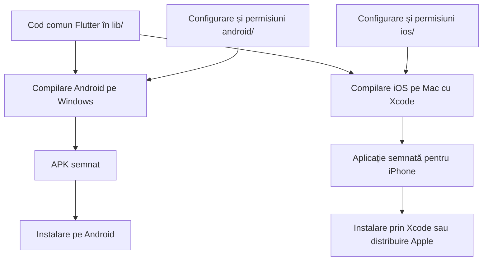

# Cum funcționează proiectul și unde modifici lucrurile

Scopul acestui document este să poți explica aplicația, să găsești locul unei modificări și să știi cum ajunge pe telefon. Prezintă codul existent și pregătirea pentru instalare. Comportamentul descris trebuie verificat și pe dispozitive, conform [ghidului de instalare](INSTALARE-TELEFON.md).

## 1. Cod, compilare, instalare

**Codul sursă** este proiectul editabil de pe calculator. **Compilarea** transformă codul într-o aplicație pentru un anumit sistem. **Instalarea** pune rezultatul pe telefon.



Telefonul rulează o copie compilată. De aceea, când editezi codul de pe Windows, aplicația deja instalată rămâne neschimbată până construiești și distribui o versiune nouă. În dezvoltare, Flutter poate trimite rapid modificări prin hot reload către o sesiune conectată, dar acesta este un instrument de lucru, nu sistemul de actualizare al aplicațiilor distribuite.

## 2. Harta proiectului

| Loc | Ce conține | Când umbli aici |
| --- | --- | --- |
| `lib/main.dart` | Punctul de intrare. Inițializează Flutter și pornește `NewsApp`. | Când schimbi inițializarea aplicației. |
| `lib/app.dart` | Numele din aplicație, limba română, alegerea temei sistemului și ecranul inițial. | Pentru configurarea generală a interfeței. |
| `lib/theme/app_theme.dart` | Culorile light/dark, fonturile, butoanele și stilurile comune. | Pentru schimbarea aspectului în toate ecranele. |
| `lib/screens/news_screen.dart` | Lista de știri și pagina de favorite. | Pentru paginile principale și acțiunile lor. |
| `lib/screens/details_screen.dart` | Detaliile știrii, rezumatul, deschiderea sursei. | Pentru pagina unui articol. |
| `lib/screens/export_dialog.dart` | Alegerea datei/calendarului și pornirea exportului. | Pentru interacțiunea de export. |
| `lib/widgets/article_card.dart` | Cardul unei știri. | Pentru cum arată o știre din listă. |
| `lib/models/article.dart` | Structura unei știri și conversia din/în JSON. | Când adaugi un câmp al știrii sau schimbi interpretarea datelor. |
| `lib/models/article_summary.dart` | Datele unui rezumat. | Când schimbi ce informații are un rezumat. |
| `lib/controllers/news_controller.dart` | Starea ecranelor: știri, favorite, încărcare, erori. | Pentru logica care coordonează interfața și serviciile. |
| `lib/services/news_api.dart` | Cererile HTTP pentru lista de știri și detalii. | Când schimbi sursa de știri sau tratarea răspunsurilor. |
| `lib/services/news_storage.dart` | Citirea și salvarea locală. | Pentru persistența favoritelor și lista păstrată offline. |
| `lib/services/article_summary_service.dart` | Citește articolul și selectează propozițiile rezumatului. | Pentru extragerea și rezumarea textului. |
| `lib/services/calendar/` | Contractul și implementările calendarului. | Pentru export și regulile evenimentelor. |
| `lib/services/app_exception.dart` | Erori cu mesaje pentru utilizator. | Pentru erorile controlate ale aplicației. |
| `pubspec.yaml` | Pachetele folosite, versiunea aplicației și configurarea Flutter. | Când adaugi o bibliotecă sau crești versiunea. |
| `pubspec.lock` | Versiunile concrete ale pachetelor rezolvate. | Îl păstrezi în proiect pentru compilări reproductibile. |
| `android/` | Proiectul nativ Android, permisiuni și semnare. | Pentru instalare/compilare Android. |
| `ios/` | Proiectul Xcode, iconițe și permisiuni Apple. | Pentru instalare/compilare iPhone. |
| `web/` | Pagina de pornire și iconițele versiunii web. | Pentru browser și iconița web de pe ecranul principal. |
| `test/` | Teste ale regulilor și fluxurilor aplicației. | Pentru verificarea comportamentului după modificări. |
| `scripts/` | Comenzi de pornire, pregătire și compilare. | Pentru automatizarea pașilor repetați. |
| `build/` | Rezultate generate de Flutter. | Le folosești pentru distribuire; modifici sursele pentru schimbări durabile. |
| `.tooling/` | Android SDK și cache Gradle instalate local de scripturi. | Unelte de lucru, nu codul aplicației. |
| `distributie/` | APK-uri și arhiva surselor pentru Mac. | De aici iei fișierele de transferat. |

Folderele `windows/`, `linux/` și `macos/` sunt proiecte pentru aplicații desktop. **`macos/` nu este versiunea pentru iPhone**; aceea este în `ios/`.

## 3. Ce se întâmplă când deschizi aplicația

1. `main.dart` pornește `NewsApp` din `app.dart`.
2. Ecranul principal folosește `NewsController` pentru știri și favorite.
3. `NewsController.initialize()` citește favoritele și ultima listă salvată din `NewsStorage`.
4. `refresh()` cere știrile actuale prin `NewsApi.frontPage()`.
5. API-ul întoarce JSON. `Article` îl transformă în obiecte Dart cu titlu, autor, dată, link și celelalte câmpuri.
6. Controllerul notifică interfața când datele sau starea încărcării se schimbă. Ecranul se reconstruiește și afișează rezultatul.
7. Dacă cererea de rețea eșuează, aplicația poate păstra lista citită local și afișează eroarea cu opțiune de reîncercare.

API-ul este un serviciu extern. Nu avem un server propriu care trebuie ținut pornit pe calculator. Adresele sunt configurate în `news_api.dart`, iar README-ul documentează endpointurile folosite.

## 4. Cum se salvează o favorită

Când apeși steaua, interfața apelează `NewsController.toggleFavorite(article)`.

Metoda construiește lista următoare de favorite, o salvează prin `NewsStorage.write()`, apoi actualizează starea vizibilă. Ordinea este intenționată: dacă salvarea eșuează, aplicația nu pretinde că favorita a fost salvată.

`NewsStorage` serializează știrile în JSON și folosește `SharedPreferencesAsync`. Pe telefon, datele sunt în spațiul local al aplicației. În browser sunt în stocarea originii web. Cheile actuale sunt `appstiri.favorites.v1` și `appstiri.frontpage.v1`.

Persistența înseamnă că datele pot fi recitite la redeschidere. Nu înseamnă sincronizare între telefoane sau backup în cloud. Dezinstalarea aplicației ori ștergerea datelor locale poate elimina favoritele.

## 5. De unde vine rezumatul

`ArticleSummaryService` citește textul articolului public prin Jina Reader. Pentru o postare fără articol extern poate folosi textul primit din API. Apoi codul selectează local propoziții relevante: maximum patru, cu un buget de 140 de cuvinte.

Este un rezumat extractiv, în limba sursei. Nu este un model generativ și nu traduce automat articolul. Rezultatele sunt păstrate temporar în memorie pentru 30 de minute. Dacă un site nu poate fi citit, pagina de detalii afișează motivul și păstrează accesul la articolul original.

Prin cererea Reader trimitem URL-ul public al articolului. Favoritele și datele calendarului nu sunt incluse în acea cerere. Detaliile integrării sunt în README.

## 6. Cum alegem calendarul potrivit platformei

`calendar_service.dart` definește operațiile comune și alege implementarea la compilare prin import condițional:

| Fișier | Rol |
| --- | --- |
| `calendar_service.dart` | Interfața comună, calendarele disponibile și rezultatul exportului. |
| `calendar_native.dart` | Android/iOS: verifică permisiunile, citește calendarele și creează evenimente prin `device_calendar`. |
| `calendar_web.dart` | Browser: descarcă un fișier `.ics`. |
| `calendar_stub.dart` | Comportamentul pentru platforme pe care integrarea nu este disponibilă. |
| `calendar_document.dart` | Intervalele orare, descrierea evenimentului și formatul `.ics`. |

Ziua aleasă în dialog determină intervalul prin `CalendarSlot.forDay()`: luni/miercuri/vineri 14:00–20:00, marți/joi 12:00–18:00, weekend 08:00–12:00. Data publicării știrii este trecută separat în descriere.

Pentru fusul orar, Dart folosește canalul `appstiri/timezone`. Codul Android din `MainActivity.kt` întoarce fusul dispozitivului, iar codul iOS din `AppDelegate.swift` întoarce identificatorul `TimeZone.current`.

Exportul nativ verifică evenimentele existente și markerul `Appstiri-ID` pentru aceeași știre, dată și oră. De aceea are nevoie și de acces de citire, pe lângă scriere. Un calendar în care nu ai drept de scriere este exclus din selecție. Testarea reală a permisiunilor depinde de telefon și conturile sale.

## 7. Ce s-a adăugat pentru instalarea nativă

| Fișier | Schimbarea și motivul |
| --- | --- |
| `android/app/build.gradle.kts` | Application ID `ro.stirifavorite.app` și semnarea release cu cheia proiectului. O compilare release fără configurarea cheii se oprește cu un mesaj util. |
| `scripts/init-android-signing.ps1` | Creează o cheie RSA și o parolă aleatoare o singură dată; nu afișează parola. |
| `scripts/android-environment.ps1` | Găsește Java și Android SDK; setează variabilele pentru procesul curent. |
| `scripts/setup-android.ps1` | Descarcă și verifică uneltele oficiale Google, apoi instalează componentele SDK. |
| `scripts/build-android.ps1` | Rulează analiza/testele, construiește APK-ul și îl copiază cu versiunea în nume. |
| `Configureaza-Android.cmd`, `Genereaza-Android.cmd` | Scurtături Windows pentru pașii de mai sus, cu fereastra păstrată deschisă pentru erori. |
| `scripts/run-android.ps1` | Folosește și SDK-ul pregătit local când pornești o sesiune de dezvoltare pe Android. |
| `scripts/generate-app-icons.ps1` | Conține desenul și generează dimensiunile Android/iOS/web fără pachete externe. |
| `assets/branding/app-icon.png` | Previzualizarea iconiței la 1024×1024. Nu este încărcată ca imagine în interfața Dart. |
| `android/app/src/main/res/mipmap-*/` | Iconițe pentru densități Android diferite; versiunea adaptivă lasă sistemul să aleagă forma. |
| `android/app/src/main/res/drawable/ic_launcher_foreground.xml`, `values/icon_colors.xml` | Desenul vectorial și fundalul iconiței adaptive. |
| `ios/Runner/Assets.xcassets/AppIcon.appiconset/` | Iconițe opace pentru iPhone/iPad și catalogul lor. |
| `ios/Runner/Info.plist` | Numele afișat pe iPhone; explicațiile existente pentru accesul la calendar sunt păstrate. |
| `ios/Runner.xcodeproj/project.pbxproj` | Bundle Identifier pentru Runner și testele sale. Contul/Team nu este inventat: îl alegi în Xcode. |
| `ios/Podfile`, `ios/Flutter/*.xcconfig` | Integrarea CocoaPods pentru pluginurile native din proiect. |
| `scripts/prepare-ios.sh` | Pregătește și verifică proiectul pe Mac, apoi deschide workspace-ul Xcode. |
| `scripts/export-mac.ps1`, `Pregateste-pentru-Mac.cmd` | Creează arhiva cu sursele necesare, fără cache-uri și chei private. |
| `web/manifest.json`, `web/index.html`, `web/icons/`, `web/favicon.png` | Același stil al iconiței și numele scurt pentru varianta web. Buildul web existent se schimbă abia după recompilare. |
| `.gitignore` | Exclude uneltele, fișierele de distribuire și cheile private din versionare. |

Namespace-ul intern Android rămâne `com.example.appstiri`, la fel ca pachetul clasei `MainActivity`. Este diferit de Application ID, ceea ce este permis: identificatorul folosit la instalare este `ro.stirifavorite.app`. Nu trebuie mutat codul Kotlin pentru această schimbare.

Semnătura certifică proveniența buildului și permite actualizări compatibile. Nu dovedește că nu există buguri și nu ține loc de aprobarea Google Play sau Apple.

## 8. Unde faci cinci modificări obișnuite

1. **Culoarea principală:** în `lib/theme/app_theme.dart`, la `AppTheme.blue` și schemele light/dark. Pentru culoarea iconiței editezi desenul din `scripts/generate-app-icons.ps1` și îl rulezi din nou pe Windows; apoi recompilezi platformele dorite.
2. **Aspectul unui card:** în `lib/widgets/article_card.dart`.
3. **Intervalele calendarului:** în `CalendarSlot.forDay()` din `calendar_document.dart`, apoi actualizezi testele relevante din `test/calendar_test.dart`.
4. **Sursa știrilor:** în `news_api.dart`; dacă se schimbă și structura JSON, adaptezi `Article` și testele API/model.
5. **Versiunea distribuită:** în `pubspec.yaml`, de exemplu `version: 1.0.1+2`, apoi reconstruiești și reinstalezi aplicațiile.

## 9. Cum verifici și cum înveți proiectul

Din rădăcina proiectului, în contul tău Windows:

```powershell
flutter analyze
flutter test
```

`test/article_api_test.dart` verifică modelele/API-ul prin răspunsuri simulate; `storage_controller_test.dart` verifică salvarea și starea; `article_summary_test.dart` verifică rezumarea și interpretarea conținutului; `calendar_test.dart` verifică regulile/exportul; `widget_test.dart` verifică fluxurile interfeței. `helpers.dart` oferă date și utilitare pentru teste.

Răspunsurile simulate fac testele repetabile și independente de internet, dar nu dovedesc că o permisiune iOS sau un calendar real funcționează. De aceea urmează și verificările manuale din ghidul de instalare.

Pentru a învăța, urmărește un singur flux: deschide aplicația → adaugă o favorită → redeschide → exportă în calendar. Pentru fiecare pas, găsește ecranul, metoda controllerului și serviciul chemat. Apoi încearcă o schimbare mică, cum ar fi o culoare, și urmărește cum apare după o nouă compilare.

Ține minte cele trei fișiere de pornire: `lib/main.dart` pornește aplicația, `pubspec.yaml` declară pachetele și versiunea, iar `docs/INSTALARE-TELEFON.md` arată cum ajunge rezultatul pe dispozitive.

Refacerea interfeței din versiunea `1.1.0+2`, animațiile, frecvența ecranului și verificările lor sunt explicate separat în [DESIGN-SI-ANIMATII.md](DESIGN-SI-ANIMATII.md). Acolo găsești pașii pentru a modifica singur o culoare, un titlu sau durata tranziției.
